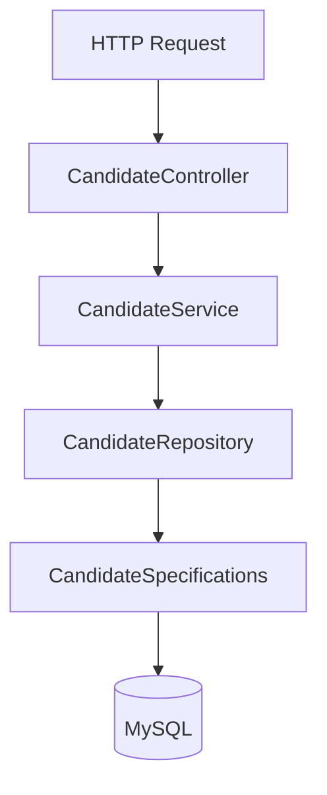

# Design Document — CandidateHub

## Architecture

Monolith with a layered structure: Controller → Service → Repository/Specifications → MySQL. DTOs separate the API contract from the persistence model, so each can evolve independently and clients can't set internal fields (`id`, `version`) on create.

**Why a monolith, not microservices:** the domain is a single bounded entity with no independent scaling or deployment need that would justify the complexity of splitting services (network calls, partial failures, service discovery). The layered structure keeps a clean seam to extract a service later if a real need emerges — see [Scaling Strategy](#scaling-strategy).

## Data Model

`candidates` holds identity, professional, and pipeline fields. `candidate_skills` is a separate one-to-many table (not a comma-separated column) so skills are individually indexable and queryable.

- `email` — unique index, enforced at both the application layer (friendly 409) and database layer (actual source of truth against race conditions).
- `status` — a Java enum stored as a string, not free text, so only valid pipeline states can ever be persisted.
- `version` — optimistic locking; a stale concurrent update returns 409 instead of silently overwriting another user's change.
- Indexes on every column actually used for filtering (`status`, `location`, `experience_years`, `source`, `notice_period_days`, `skill`), so Specification queries stay performant as data grows.

## Key API Decisions

(Endpoints and parameters are documented in the [README](./README.md); this covers the reasoning.)

- **Multi-criteria search via JPA Specifications**, not one repository method per filter combination — every filter is optional and independently composable; adding a new filter means adding one predicate, not a new method.
- **Pagination capped at 100 server-side** regardless of what a client requests — prevents an unbounded result set from degrading performance.
- **PUT currently does a partial update** (omitted fields left unchanged, not cleared) — pragmatic for this domain, where accidental data loss from an incomplete payload is a bigger risk than strict REST semantics. A PATCH endpoint for true partial updates, alongside a strict full-replace PUT, is a natural next step.
- **201 + Location header on create, 204 on delete** — correct REST status codes rather than defaulting everything to 200.

## Error Handling

A centralized `@RestControllerAdvice` maps exceptions to RFC 7807 `ProblemDetail` responses:

| Exception | Status |
|---|---|
| Candidate not found | 404 |
| Duplicate email | 409 |
| Concurrent edit (optimistic lock) | 409 |
| Validation failure | 400 (with per-field detail) |
| Invalid query param / enum | 400 |
| Unexpected error | 500 (logged in full server-side; generic message to client) |

Duplicate-email detection uses "check, then catch": an existence check gives a fast, friendly rejection in the common case; catching the database's own unique-constraint violation is the backstop for the rare race condition.

## Security & Logging

All inputs validated via Bean Validation; all queries parameterized via JPA (no SQL injection risk); `LIKE` wildcard characters are escaped in free-text search. No internal details or stack traces are ever returned to clients. SLF4J logging at INFO for key business events (create/update/delete), ERROR with full trace for unexpected failures — PII is not logged beyond candidate id. Authentication/authorization is out of scope for this assignment but would be the first addition for production use.

## Testing Strategy

Three layers, each verifying something distinct:

1. **Unit** (`CandidateServiceTest`) — business logic with mocked dependencies.
2. **Repository** (`CandidateSpecificationsTest`, `@DataJpaTest`) — dynamic filtering against in-memory H2, including AND/OR skill semantics and wildcard escaping.
3. **Integration** (`CandidateControllerIntegrationTest`, `@SpringBootTest` + MockMvc) — full HTTP stack end to end.

H2 is used so the suite runs fast with no Docker/MySQL dependency. Trade-off: H2 approximates MySQL but isn't identical — two real dialect differences surfaced and were fixed during development (MySQL's `UNIQUE KEY` syntax vs. standard SQL; a stricter `LIKE ESCAPE` character requirement). Testcontainers (already a dependency) is the natural next step for verifying against real MySQL before release.

## Scaling Strategy

Assuming substantially more users and records:

- **Database**: read replicas for search traffic; keyset (seek) pagination for deep pages; MySQL FULLTEXT or a dedicated search index for free-text search at scale.
- **Search**: if relational filtering becomes a bottleneck, move to OpenSearch/Elasticsearch, with MySQL as source of truth and CDC (e.g. Debezium → Kafka) keeping the index in sync — also unlocks relevance ranking and fuzzy matching.
- **Caching**: Redis for hot reads and filter-facet counts.
- **Application tier**: already stateless — horizontal scaling behind a load balancer needs no code changes.
- **Multi-tenancy**: add and index/partition by `tenant_id` if serving multiple organizations.
- **Async work**: bulk imports, resume parsing, and notifications move to a queue (Kafka) rather than synchronous handling.
- **Observability**: metrics (Micrometer/Prometheus) and tracing (OpenTelemetry) become necessary beyond what logs alone can explain.

The existing layered separation (Specifications/Service/Repository) makes it straightforward to extract any one piece into its own service later, if an independent-scaling need genuinely emerges.
